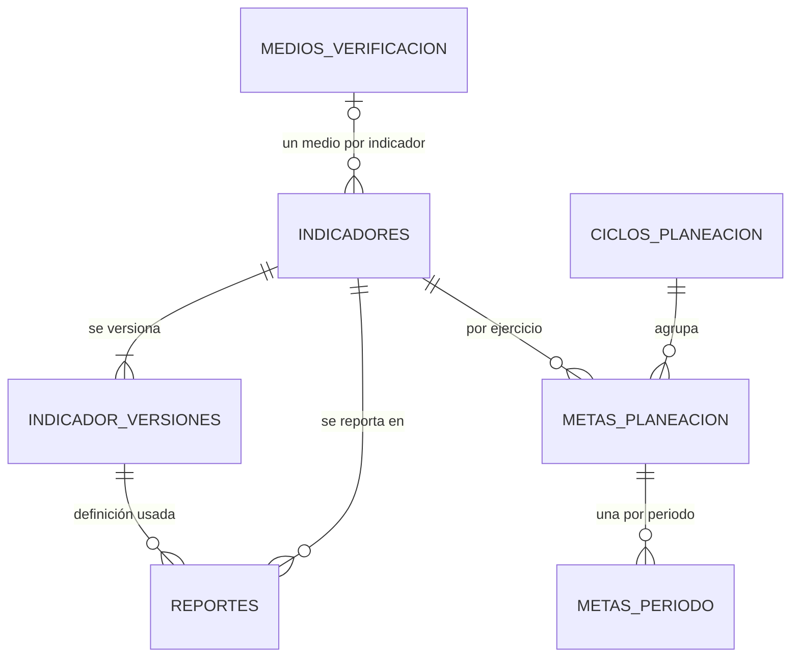

# Diccionario de datos — versiones del indicador, medios de verificación y metas

Versión 1.0 · 14 de octubre de 2026 · Ficha de modelo de indicadores y metas (tarea técnica transversal)
Migraciones `20261014000001` a `20261014000004`. Complementa a [DICCIONARIO.md](DICCIONARIO.md) (S1) con las
mismas convenciones.

| En el RQM | En la base | Nota |
|---|---|---|
| INDICADORES | `indicadores` + `indicador_versiones` | La definición vigente y su historia |
| MEDIOS_VERIFICACION | `medios_verificacion` | Un medio por indicador (decisión 14/10/2026) |
| CICLOS_PLANEACION | `ciclos_planeacion` | |
| METAS_PLANEACION | `metas_planeacion` | En EXTENSION.md se llamaba METAS |
| METAS_PERIODO | `metas_periodo` | |

## medios_verificacion

Catálogo de medios de verificación. `indicadores.medio_verificacion_id` apunta aquí.

| Campo | Tipo | Nulo | Default | Restricciones | Descripción |
|---|---|---|---|---|---|
| id | uuid | no | `gen_random_uuid()` | PK | |
| nombre | text | no | | no vacío; único sin distinguir mayúsculas ni espacios (`medio_normalizado(nombre)`) | Texto sin espacios de más |
| activo | boolean | no | `true` | | |
| created_at / updated_at | timestamptz | no | `now()` | | |

**Transición (primero se agrega, después se quita).** `indicadores.medio_verificacion` (texto) sigue
mientras el código y la carga inicial lo usen. El trigger `indicadores_medio` los mantiene alineados:
escribir el texto crea o encuentra el medio y llena la FK, y deja el texto como lo escribe el catálogo;
elegir la FK llena el texto. Texto vacío = sin medio. Una migración posterior quita la columna de texto.

## indicador_versiones

Historia de la configuración de cada indicador (CA-3) y de su asignación (gerencia y unidad).

| Campo | Tipo | Nulo | Default | Restricciones | Descripción |
|---|---|---|---|---|---|
| id | uuid | no | `gen_random_uuid()` | PK; UNIQUE (id, indicador_id) | |
| indicador_id | uuid | no | | FK → indicadores (se borra con él solo si ningún reporte usa sus versiones) | |
| version | smallint | no | | > 0; UNIQUE (indicador_id, version) | 1, 2, 3… |
| gerencia_id | uuid | no | | FK → gerencias | Asignación en esta versión |
| unidad_id | uuid | sí | | FK (unidad_id, gerencia_id) → unidades | |
| definicion | jsonb | no | | | La fila del indicador sin `id`, fechas ni `activo` (`indicador_definicion()`) |
| vigente_desde | timestamptz | no | `now()` | | |
| created_at | timestamptz | no | `now()` | | |

**Reglas (triggers).**

- `indicadores_version` (AFTER INSERT/UPDATE en indicadores): si la definición cambió, y la versión
  vigente ya la usa un reporte, crea la siguiente; si no la usa nadie, la actualiza en su lugar. Guardar sin
  cambios no crea versión. Así las ediciones previas a reportar no inflan la historia.
- `indicador_versiones_proteccion`: una versión que usa un reporte no se modifica ni se borra; ninguna
  cambia de indicador ni de número.
- Al migrar, cada indicador existente recibió la versión 1 con su configuración de ese momento, y los
  reportes de S1 apuntan a ella. La foto de S1 en `reportes` sigue intacta.

## reportes — columna nueva

| Campo | Tipo | Nulo | Restricciones | Descripción |
|---|---|---|---|---|
| indicador_version_id | uuid | no | FK (indicador_version_id, indicador_id) → indicador_versiones | Versión del indicador con la que se creó el reporte |

`reportes_version` la llena al crear el reporte, siempre con la versión vigente (no la del INSERT);
`reportes_version_fija` impide cambiarla, ni con reapertura autorizada. La foto de S1 (frecuencia, tipo de
cálculo, rangos…) se mantiene: el cierre y los tableros la leen sin JOIN.

## ciclos_planeacion

Un ciclo de planeación por ejercicio, con fase de captura y fase de revisión (HU-R4-01). La fase se calcula
de las fechas y de `cerrado_manual`; no se guarda.

| Campo | Tipo | Nulo | Default | Restricciones | Descripción |
|---|---|---|---|---|---|
| id | uuid | no | `gen_random_uuid()` | PK | |
| ejercicio | smallint | no | | UNIQUE; 2000–2100 | Un ciclo por ejercicio (HU-R4-01 RN_1) |
| inicio_captura, fin_captura | date | no | | fin > inicio (HU-R4-01 CA_3) | |
| inicio_revision | date | no | | ≥ fin_captura | |
| cerrado_manual | boolean | no | `false` | ⇔ cerrado_at | El Admin cierra la revisión (HU-R4-05 RN_4) |
| abierto_por, cerrado_por | uuid | sí | | FK → usuarios | |
| abierto_at | timestamptz | no | `now()` | | |
| cerrado_at | timestamptz | sí | | | |
| created_at / updated_at | timestamptz | no | `now()` | | |

## metas_planeacion

Meta de un indicador en un ejercicio, versionada (CA-2). Una sola versión vigente por indicador y ejercicio
(la meta lógica); un cambio autorizado (HU-R4-12 RN_3) marca la vigente como histórica y crea la siguiente.

| Campo | Tipo | Nulo | Default | Restricciones | Descripción |
|---|---|---|---|---|---|
| id | uuid | no | `gen_random_uuid()` | PK | |
| indicador_id | uuid | no | | FK → indicadores | |
| ciclo_id | uuid | no | | FK → ciclos_planeacion | El ejercicio |
| version | smallint | no | `1` | > 0; UNIQUE (indicador_id, ciclo_id, version) | |
| vigente | boolean | no | `true` | Índice único parcial (indicador_id, ciclo_id) WHERE vigente | |
| estado | text | no | `'meta_pendiente'` | CHECK `meta_pendiente`, `borrador_meta`, `meta_enviada`, `meta_observada`, `meta_corregida`, `meta_validada` | `fijada` y `cambio_en_revision` dependen de la pregunta 22 |
| intento | smallint | no | `0` | ≥ 0 | Sube en cada observación → corrección |
| vencida, vencida_at | boolean, timestamptz | | `false` | vencida ⇔ vencida_at | Envío fuera de captura (HU-R4-02 RN_2); marca, no estado |
| meta_anual, linea_base | numeric | sí | | ≥ 0; obligatorias desde `meta_enviada` (HU-R4-04 CA_1) | |
| justificacion | text | sí | | | |
| enviada_por/at | uuid, timestamptz | sí | | enviada_at obligatoria desde `meta_enviada` | |
| validada_por/at | uuid, timestamptz | sí | | validada_at ⇔ `meta_validada` | |
| lock_version | integer | no | `0` | | Control optimista; sube en cada UPDATE |
| created_at / updated_at | timestamptz | no | `now()` | | |

`metas_planeacion_proteccion`: las metas no se borran; una versión histórica no se modifica; ninguna cambia
de indicador, ejercicio ni versión.

## metas_periodo

La meta de cada periodo dentro de una versión de meta. El periodo es un número, no texto («T1-2026»).

| Campo | Tipo | Nulo | Restricciones | Descripción |
|---|---|---|---|---|
| meta_id | uuid | no | FK → metas_planeacion; PK (meta_id, numero) | Periodos únicos dentro de su versión |
| numero | smallint | no | 1–12 y ≤ periodos por año de la frecuencia del indicador (trigger) | |
| meta_periodo | numeric | no | ≥ 0 | |

`metas_periodo_validacion`: valida el número contra la frecuencia e impide tocar los periodos de una
versión histórica.

## Índices nuevos

| Índice | Tabla | Para qué |
|---|---|---|
| `medios_verificacion_nombre` (único, normalizado) | medios_verificacion | Sin medios duplicados |
| `indicadores_medio` | indicadores | Indicadores de un medio |
| `indicador_versiones_gerencia` | indicador_versiones | Asignación histórica por gerencia |
| `reportes_indicador_version` | reportes | ¿Ya usa alguien esta versión? (trigger de versionado) |
| `metas_planeacion_vigente` (único, parcial) | metas_planeacion | Una meta lógica por indicador y ejercicio |
| `metas_planeacion_ciclo_estado` (parcial) | metas_planeacion | Avance de planeación por ejercicio |

## Permisos del rol de la app

`SELECT` en `indicador_versiones` y `medios_verificacion` (el trigger de reportes lee la versión al generar
reportes en R3-01). Ciclos y metas: sin permisos hasta que el código de R4 los use.
