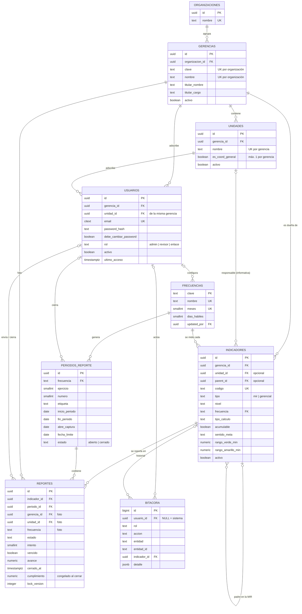
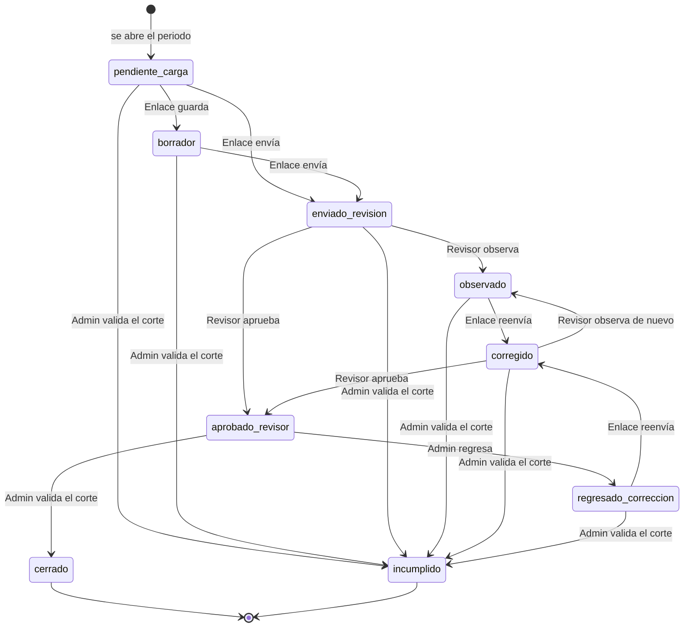

# Diccionario de datos — COMAPA MIR (S1)

Versión 1.0 · 8 de octubre de 2026 · TEC-01 / TEC-02
Motor: PostgreSQL 14 o superior. Fuente de verdad: `migrations/`; este documento se actualiza con cada migración.

> **Versiones del indicador, medios de verificación, ciclos y metas** (migraciones del 14/10/2026):
> [DICCIONARIO-PLANEACION.md](DICCIONARIO-PLANEACION.md).

**Convenciones**

- Llaves primarias `uuid` generadas por la base (`gen_random_uuid()`), salvo catálogos con clave natural (`frecuencias`) y la bitácora (entero consecutivo).
- Catálogos de valores como `text` + `CHECK`, no enums nativos: cambiar un valor es una migración de una línea.
- Fechas con hora en `timestamptz`; fechas sin hora en `date`.
- `created_at` lo pone la base; `updated_at` lo mantiene un trigger en cada UPDATE.
- Nada se borra: catálogos y usuarios se desactivan (`activo = false`).

## Diagrama entidad-relación

## Equivalencia con el RQM y el modelo de 27 tablas

| En el RQM / modelo | En la base | Nota |
|---|---|---|
| CICLOS / PERIODOS_REPORTE | `periodos_reporte` | Separa el periodo medido de la ventana de captura |
| AUDIT_LOG / BITACORA | `bitacora` | Con `indicador_id` para el historial por indicador |
| CONFIG_VENTANAS_CAPTURA | `frecuencias` | El catálogo de frecuencias y su ventana en una sola tabla |
| REPORTES_PERIODO | columnas de cierre en `reportes` | Era 1:1 con REPORTES; el congelado vive en la misma fila |
| USUARIO_GERENCIAS | — | Eliminada: los indicadores son de la gerencia y cada usuario tiene una sola |
| MEDIOS_VERIFICACION, CICLOS_PLANEACION, METAS_PLANEACION, METAS_PERIODO + versiones del indicador | ver [DICCIONARIO-PLANEACION.md](DICCIONARIO-PLANEACION.md) | 14/10/2026 |
| INDICADOR_CAMBIOS_PROGRAMADOS | `indicador_cambios_programados` | S2-TEC-01; mismo nombre que el RQM (la columna `vigente_desde_periodo` no se usa, ver [DECISIONES.md](DECISIONES.md)) |
| COMENTARIOS, EVIDENCIAS, REPORTE_VERSIONES, VALIDACIONES_PERIODO… | — | Extensión futura, ver [EXTENSION.md](EXTENSION.md) |

---

## organizaciones

Organismo operador. Hoy solo COMAPA Sur; existe para sumar organismos sin migración destructiva (RNF Escalabilidad).

| Campo | Tipo | Nulo | Default | Restricciones | Descripción |
|---|---|---|---|---|---|
| id | uuid | no | `gen_random_uuid()` | PK | |
| nombre | text | no | | UNIQUE | Nombre del organismo |
| created_at | timestamptz | no | `now()` | | |

## gerencias

| Campo | Tipo | Nulo | Default | Restricciones | Descripción |
|---|---|---|---|---|---|
| id | uuid | no | `gen_random_uuid()` | PK | |
| organizacion_id | uuid | no | | FK → organizaciones | |
| clave | text | no | | UNIQUE (organizacion_id, clave) | Prefijo de la gerencia: PLA, COM, ADM, TEC |
| nombre | text | no | | UNIQUE (organizacion_id, nombre) | |
| titular_nombre | text | sí | | | Titular que firma los PDF |
| titular_cargo | text | sí | | | Cargo del titular |
| activo | boolean | no | `true` | | |
| created_at / updated_at | timestamptz | no | `now()` | | |

## unidades

Coordinaciones o áreas de una gerencia. Son informativas: no limitan qué indicadores ve un usuario.

| Campo | Tipo | Nulo | Default | Restricciones | Descripción |
|---|---|---|---|---|---|
| id | uuid | no | `gen_random_uuid()` | PK; UNIQUE (id, gerencia_id) | El par permite FK compuestas que garantizan que la unidad sea de la gerencia |
| gerencia_id | uuid | no | | FK → gerencias | |
| nombre | text | no | | UNIQUE (gerencia_id, nombre) | Puede repetirse en otra gerencia |
| es_coord_general | boolean | no | `false` | Índice único parcial: máximo una por gerencia | Coordinación General de la gerencia |
| activo | boolean | no | `true` | | |
| created_at / updated_at | timestamptz | no | `now()` | | |

## usuarios

Un usuario tiene un rol, una gerencia y una unidad de adscripción (RQM HU-R7-07, HU-R7-03 RN_3). Cualquier Enlace de la gerencia puede reportar todos sus indicadores (HU-R1-01 RN_1).

| Campo | Tipo | Nulo | Default | Restricciones | Descripción |
|---|---|---|---|---|---|
| id | uuid | no | `gen_random_uuid()` | PK | |
| gerencia_id | uuid | no | | FK → gerencias | Define qué indicadores ve el Enlace o el Revisor |
| unidad_id | uuid | no | | FK (unidad_id, gerencia_id) → unidades | Adscripción; la unidad debe ser de su gerencia |
| nombre | text | no | | | Nombre completo |
| email | citext | no | | UNIQUE; CHECK formato `x@y.z` | Correo institucional; único sin distinguir mayúsculas |
| password_hash | text | no | | | Hash bcrypt de 12 rondas o más (HU-R7-01 RN_1) |
| debe_cambiar_password | boolean | no | `true` | | Contraseña temporal pendiente de cambio |
| rol | text | no | | CHECK `admin`, `revisor`, `enlace` | Un solo rol por usuario |
| activo | boolean | no | `true` | | Un inactivo no inicia sesión y conserva su historial |
| ultimo_acceso | timestamptz | sí | | | |
| created_at / updated_at | timestamptz | no | `now()` | | |

## frecuencias

Catálogo fijo de las seis frecuencias y su ventana de captura (antes CONFIG_VENTANAS_CAPTURA). `meses` da los periodos por año (12 / meses) y los meses de corte.

| Campo | Tipo | Nulo | Default | Restricciones | Descripción |
|---|---|---|---|---|---|
| clave | text | no | | PK; CHECK de los 6 valores | |
| nombre | text | no | | UNIQUE | Nombre visible |
| meses | smallint | no | | UNIQUE; CHECK 1, 2, 3, 4, 6, 12 | Duración del periodo |
| dias_habiles | smallint | no | | CHECK > 0 y ≤ meses × 23 | Días hábiles de captura; no puede exceder el periodo (HU-R3-01 CA_2) |
| updated_por | uuid | sí | | FK → usuarios | Último Administrador que la cambió |
| updated_at | timestamptz | no | `now()` | | |

Datos iniciales (los de la pantalla de Configuración):

| clave | meses | dias_habiles |
|---|---|---|
| mensual | 1 | 10 |
| bimestral | 2 | 12 |
| trimestral | 3 | 15 |
| cuatrimestral | 4 | 18 |
| semestral | 6 | 20 |
| anual | 12 | 30 |

## indicadores

Solo la definición del indicador. No guarda estado (vive en `reportes`) ni metas (viven en METAS por ejercicio).

| Campo | Tipo | Nulo | Default | Restricciones | Descripción |
|---|---|---|---|---|---|
| id | uuid | no | `gen_random_uuid()` | PK | |
| gerencia_id | uuid | no | | FK → gerencias | Gerencia dueña del indicador |
| unidad_id | uuid | sí | | FK (unidad_id, gerencia_id) → unidades | Unidad responsable, informativa |
| parent_id | uuid | sí | | FK → indicadores; distinto de id | Indicador padre en la MIR |
| codigo | text | no | | UNIQUE | Clave visible (COM-ACT-08); editable, no se genera con contadores |
| tipo | text | no | `'mir'` | CHECK `mir`, `gerencial` | Los gerenciales no pasan por el Revisor |
| nivel | text | sí | | CHECK `fin`, `proposito`, `componente`, `actividad`; obligatorio si tipo = mir | |
| numero | text | sí | | | Numeración de la MIR: 1, 1.2, 1.2.3 |
| nombre | text | no | | | |
| resumen_narrativo | text | sí | | | |
| tipo_indicador | text | sí | | CHECK `estrategico`, `gestion` | |
| unidad_medida | text | no | | | Porcentaje, Número, MXN… |
| frecuencia | text | no | | FK → frecuencias | |
| tipo_calculo | text | no | `'valor_directo'` | CHECK `valor_directo`, `fraccion` | En fracción, avance = numerador / denominador × 100 |
| formula | text | sí | | | Fórmula descriptiva |
| numerador_desc | text | sí | | | Etiqueta del numerador |
| denominador_desc | text | sí | | | Etiqueta del denominador |
| denominador_fijo | numeric | sí | | CHECK > 0; solo si tipo_calculo = fraccion | Valor fijo; solo lo cambia el Administrador |
| acumulable | boolean | no | `false` | | Si sí, se compara la suma de avances contra la suma de metas |
| sentido_meta | text | no | `'ascendente'` | CHECK `ascendente`, `descendente` | Descendente: menos es mejor (rezago, demandas) |
| medio_verificacion | text | sí | | | En transición: alineado por trigger con `medio_verificacion_id`; se quitará cuando el código lea el catálogo |
| medio_verificacion_id | uuid | sí | | FK → medios_verificacion | Un medio por indicador ([DICCIONARIO-PLANEACION.md](DICCIONARIO-PLANEACION.md)) |
| origen_mv | text | sí | | CHECK `interno`, `externo`, `mixto` | |
| supuestos | text | sí | | | |
| es_iso | boolean | no | `false` | | |
| observaciones_mir | text | sí | | | Notas del Excel; no son observaciones del Revisor |
| rango_verde_min | numeric | no | `95` | CHECK amarillo < verde ≤ 100 | Umbral verde del semáforo |
| rango_amarillo_min | numeric | no | `80` | CHECK 0 < amarillo | Umbral amarillo |
| activo | boolean | no | `true` | | Uno inactivo no genera reportes nuevos; conserva su historial |
| created_at / updated_at | timestamptz | no | `now()` | | |

## periodos_reporte

Un periodo de reporte por frecuencia (los CICLOS del RQM). Separa el periodo que se mide de la ventana en que se captura: el anual 2025 se captura del 1 al 30 de enero de 2026. El corte mensual de validación de la gerencia es el mes de `fin_periodo`.

| Campo | Tipo | Nulo | Default | Restricciones | Descripción |
|---|---|---|---|---|---|
| id | uuid | no | `gen_random_uuid()` | PK; UNIQUE (id, frecuencia) | El par permite la FK compuesta desde reportes |
| frecuencia | text | no | | FK → frecuencias | |
| ejercicio | smallint | no | | CHECK 2020–2100 | Año fiscal |
| numero | smallint | no | | CHECK 1–12; UNIQUE (frecuencia, ejercicio, numero) | Número de periodo en el año: 5 = mayo, 2 = T2 |
| etiqueta | text | no | | UNIQUE (frecuencia, etiqueta) | Nombre visible: mayo-2026, T2-2026 |
| inicio_periodo | date | no | | CHECK inicio ≤ fin | Primer día del periodo medido |
| fin_periodo | date | no | | | Último día del periodo medido; define el corte |
| abre_captura | date | no | | CHECK abre ≤ fecha_limite | Apertura de la ventana de captura |
| fecha_limite | date | no | | | Se calcula al crear el periodo y no se recalcula |
| estado | text | no | `'abierto'` | CHECK `abierto`, `cerrado` | |
| cerrado_por | uuid | sí | | FK → usuarios | |
| cerrado_at | timestamptz | sí | | CHECK obligatorio si estado = cerrado | |
| created_at | timestamptz | no | `now()` | | |

## reportes

Un reporte lógico por indicador y periodo (TEC-01 CA-3). El estado vive aquí y no en el indicador, así que un mismo indicador puede estar cerrado en un periodo y pendiente en el siguiente.

**Identidad**

| Campo | Tipo | Nulo | Default | Restricciones | Descripción |
|---|---|---|---|---|---|
| id | uuid | no | `gen_random_uuid()` | PK | |
| indicador_id | uuid | no | | FK → indicadores; UNIQUE (indicador_id, periodo_id) | |
| periodo_id | uuid | no | | FK (periodo_id, frecuencia) → periodos_reporte | El periodo debe ser de la frecuencia del indicador |

**Foto de la configuración.** La llena un trigger al crear el reporte, siempre desde el catálogo, e impide modificarla después. Los cambios al indicador aplican solo a reportes nuevos (HU-R4-11 CA_4). Desde el 14/10/2026 cada reporte apunta además a la versión completa del indicador (`indicador_version_id`, ver [DICCIONARIO-PLANEACION.md](DICCIONARIO-PLANEACION.md)).

| Campo | Tipo | Nulo | Restricciones | Descripción |
|---|---|---|---|---|
| gerencia_id | uuid | no | FK → gerencias | Gerencia dueña en ese periodo |
| unidad_id | uuid | sí | FK (unidad_id, gerencia_id) → unidades | |
| frecuencia | text | no | Parte de la FK al periodo | |
| tipo_calculo | text | no | | |
| acumulable | boolean | no | | |
| sentido_meta | text | no | | |
| rango_verde_min | numeric | no | | |
| rango_amarillo_min | numeric | no | | |

**Flujo y captura**

| Campo | Tipo | Nulo | Default | Restricciones | Descripción |
|---|---|---|---|---|---|
| estado | text | no | `'pendiente_carga'` | CHECK de los 9 estados (ver abajo) | |
| intento | smallint | no | `0` | CHECK ≥ 0 | Sube en cada ciclo observado → corregido |
| vencido | boolean | no | `false` | CHECK vencido ⇔ vencido_at no nulo | Marca de entrega tardía; no es estado y no se quita al enviar (HU-R1-08 RN_5) |
| vencido_at | timestamptz | sí | | | Cuándo se marcó |
| numerador | numeric | sí | | CHECK ≥ 0 | Solo en fracción |
| denominador | numeric | sí | | CHECK > 0 | Solo en fracción |
| avance | numeric | sí | | CHECK ≥ 0 | Avance del periodo; 0 es válido (HU-R1-03 RN_4) |
| enviado_por | uuid | sí | | FK → usuarios | Último Enlace que envió |
| enviado_at | timestamptz | sí | | Obligatorio en enviado_revision, observado, corregido, aprobado_revisor, regresado_correccion | |

**Cierre (congelado).** Se llena al cerrar y no cambia después, aunque se autorice un cambio de meta (HU-R3-03 CA_4, HU-R4-12 CA_4).

| Campo | Tipo | Nulo | Restricciones | Descripción |
|---|---|---|---|---|
| meta_periodo_aplicada | numeric | sí | Solo si cerrado_at no es nulo | Meta con la que se evaluó |
| cumplimiento | numeric | sí | Solo si cerrado_at no es nulo | % de cumplimiento final |
| semaforo | text | sí | CHECK `verde`, `amarillo`, `rojo`, `na`; solo si cerrado_at no es nulo | `na` si la meta es 0 o no existe (HU-R1-05 RN_5) |
| cerrado_por | uuid | sí | FK → usuarios | |
| cerrado_at | timestamptz | sí | CHECK obligatorio ⇔ estado cerrado o incumplido | |

**Control**

| Campo | Tipo | Nulo | Default | Descripción |
|---|---|---|---|---|
| lock_version | integer | no | `0` | Sube en cada UPDATE; control optimista (`WHERE lock_version = $n`) |
| created_at / updated_at | timestamptz | no | `now()` | |

### Estados del reporte

La base solo acepta estos nueve valores. Las transiciones las valida el backend.

- **Cerrado e incumplido son finales.** Un trigger rechaza cualquier cambio salvo que el backend lo autorice en la misma transacción (`SET LOCAL app.reapertura = 'on'`), para el override o la reapertura del Administrador, que se registran en la bitácora.
- **Indicadores gerenciales:** sin Revisor; el Administrador aprueba (→ cerrado) u observa (→ observado).
- **Vencido** es una marca sobre cualquier estado no enviado, no un estado.

## bitacora

AUDIT_LOG del RQM. Solo inserción: un trigger rechaza UPDATE, DELETE y TRUNCATE.

| Campo | Tipo | Nulo | Default | Restricciones | Descripción |
|---|---|---|---|---|---|
| id | bigint | no | identidad | PK | Consecutivo; da el orden cronológico |
| usuario_id | uuid | sí | | FK → usuarios | NULL = acción del sistema (jobs) |
| rol | text | sí | | CHECK de roles; nulo ⇔ usuario_id nulo | Rol al momento de la acción |
| accion | text | no | | | enviado_revision, override_manual, marcado_vencido… |
| entidad | text | no | | | reporte, usuario, indicador, frecuencia… |
| entidad_id | text | no | | | Texto porque algunas llaves no son uuid (frecuencias) |
| indicador_id | uuid | sí | | FK → indicadores | Para el historial por indicador (HU-R5-04) |
| estado_anterior | text | sí | | | |
| estado_nuevo | text | sí | | | |
| comentario | text | sí | | | Justificación (override, reapertura) |
| detalle | jsonb | sí | | | Valores anteriores y nuevos, filtros de exportación, intento… |
| ip | inet | sí | | | |
| created_at | timestamptz | no | `now()` | | |

## login_intentos

Fallos consecutivos de inicio de sesión por correo y bloqueo temporal (HU-R7-06): 5 fallos bloquean 15 minutos.
Sin FK a usuarios: un correo que no existe también se cuenta, así el login no revela qué correos están registrados.
Los eventos de bloqueo y desbloqueo van a `bitacora` con `entidad = 'acceso'` y el correo en `entidad_id`.

| Campo | Tipo | Nulo | Default | Restricciones | Descripción |
|---|---|---|---|---|---|
| email | citext | no | | PK | Correo tal como se intentó, normalizado a minúsculas y sin espacios |
| intentos | smallint | no | `0` | CHECK `>= 0` | Fallos consecutivos; un login correcto borra la fila |
| ultimo_intento_at | timestamptz | no | `now()` | | Último fallo registrado |
| bloqueado_hasta | timestamptz | sí | | | NULL = sin bloqueo; vencido = la cuenta se abre y el siguiente fallo cuenta desde 1 |

## indicador_cambios_programados

INDICADOR_CAMBIOS_PROGRAMADOS (HU-R4-11 CA_4). Cambios de gerencia, frecuencia, tipo de cálculo y acumulable
de un indicador **con reportes o metas**: no se escriben en `indicadores` al editar, se guardan aquí con los
valores nuevos y se aplican al abrir el siguiente periodo. Los reportes y las metas ya creados no cambian
(apuntan a su versión del indicador, ver [DICCIONARIO-PLANEACION.md](DICCIONARIO-PLANEACION.md)). Tabla aparte y no `vigente_desde_periodo` en INDICADORES, por decisión de Arquitectura
([DECISIONES.md](DECISIONES.md)). Nada se borra.

| Campo | Tipo | Nulo | Default | Restricciones | Descripción |
|---|---|---|---|---|---|
| id | uuid | no | `gen_random_uuid()` | PK | |
| indicador_id | uuid | no | | FK → indicadores | |
| valores | jsonb | no | | Objeto no vacío cuyas claves son solo `gerencia_id`, `unidad_id`, `frecuencia`, `tipo_calculo`, `acumulable` | Solo los valores nuevos, con el nombre de la columna. `unidad_id` viaja con un cambio de gerencia |
| vigente_desde | date | no | | | Apertura del siguiente periodo de la frecuencia que tenía el indicador al programarlo |
| creado_por | uuid | sí | | FK → usuarios | Administrador que lo programó |
| created_at | timestamptz | no | `now()` | | |
| aplicado_at | timestamptz | sí | | No junto con `cancelado_at` | Lo fija la apertura del periodo, en su transacción |
| cancelado_at | timestamptz | sí | | No junto con `aplicado_at` | Cancelado por el Administrador antes de que abra el periodo |
| cancelado_por | uuid | sí | | FK → usuarios; solo con `cancelado_at` | |

**Quién escribe y cuándo aplica.** La API de edición del catálogo (`PUT /api/admin/indicadores/:id`) inserta;
`POST /api/admin/cambios-programados/:id/cancelar` cancela. `aplicarCambiosProgramados` (`src/datos/cambiosProgramados.ts`)
aplica los pendientes con `vigente_desde <= hoy` dentro de la transacción de `abrirCiclos` (periodo de reporte de
su frecuencia), antes de generar los reportes. Abrir un ciclo de planeación debe llamarla igual (ticket 8, pendiente).
Un indicador tiene a lo sumo un cambio pendiente: uno nuevo cancela y reemplaza al anterior (conserva sus valores).
Cada paso queda en la bitácora: `cambio_programado`, `cambio_programado_cancelado` y `cambio_programado_aplicado`
(con `antes`, `despues` y `vigente_desde`).

---

## Índices

| Índice | Tabla | Para qué |
|---|---|---|
| UNIQUE email | usuarios | Login por correo |
| `usuarios_gerencia_rol` (activos) | usuarios | Enlaces y Revisores de una gerencia |
| `unidades_una_coord_general` (parcial) | unidades | Una Coordinación General por gerencia |
| `indicadores_gerencia`, `indicadores_frecuencia` (activos) | indicadores | Catálogo por gerencia; job de apertura por frecuencia |
| `periodos_reporte_fin` | periodos_reporte | Reportes de un corte mensual |
| `periodos_reporte_abiertos` (parcial) | periodos_reporte | Periodos abiertos por frecuencia |
| `reportes_periodo_gerencia_estado` | reportes | Bandejas y tableros del periodo |
| `reportes_gerencia_estado` | reportes | KPIs por gerencia |
| `bitacora_indicador`, `bitacora_entidad`, `bitacora_usuario` | bitacora | Historial por indicador, por registro y por usuario |
| `indicador_cambios_pendiente` (único parcial) | indicador_cambios_programados | Un cambio pendiente por indicador |
| `indicador_cambios_por_vigencia` (parcial) | indicador_cambios_programados | Qué cambios toca aplicar al abrir un periodo |

## Triggers

| Trigger | Tabla | Qué hace |
|---|---|---|
| `*_updated_at` | gerencias, unidades, usuarios, frecuencias, indicadores, reportes | Actualiza `updated_at` |
| `reportes_foto` | reportes | Copia la configuración del indicador al crear; rechaza indicadores inexistentes o inactivos |
| `reportes_proteccion` | reportes | Impide borrar, cambiar la foto o editar un reporte cerrado o incumplido sin autorización; sube `lock_version` |
| `bitacora_sin_cambios`, `bitacora_sin_truncate` | bitacora | Solo inserción |
| `meta_versiones_sin_cambios` | meta_versiones | Solo inserción (`solo_insercion()`) |
| `cambios_programados_proteccion` | indicador_cambios_programados | Impide borrar, cambiar lo programado o tocar uno ya aplicado o cancelado |

## Cobertura de TEC-01

| Criterio | Dónde se cumple |
|---|---|
| CA-1: USUARIOS, GERENCIAS, UNIDADES, INDICADORES, CICLOS, REPORTES y AUDIT_LOG | Este documento; CICLOS = `periodos_reporte`, AUDIT_LOG = `bitacora` |
| CA-2: organización, rol único, correo único, unidad dentro de la gerencia | `organizaciones`; `usuarios.rol`; `usuarios.email` UNIQUE citext; FK compuesta (unidad_id, gerencia_id) |
| CA-3: un reporte lógico por indicador y ciclo | `reportes` UNIQUE (indicador_id, periodo_id) |
| CA-4: extensión futura para metas, observaciones, evidencias y versiones | [EXTENSION.md](EXTENSION.md) |
| Separar INDICADORES de REPORTES por ciclo y de metas por ejercicio | Estado en `reportes`; metas en METAS por ejercicio ([EXTENSION.md](EXTENSION.md)) |
| Conservar gerencia y configuración histórica de cada reporte | Foto en `reportes` + congelado al cierre |
| Casos: varias frecuencias, varios Enlaces por gerencia, periodos anteriores | `pruebas/restricciones.sql` |
