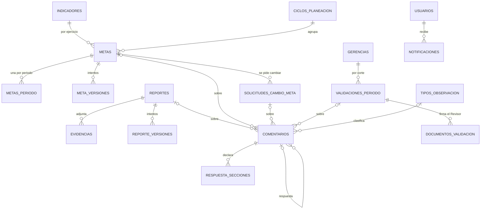

# Extensión futura del modelo — COMAPA MIR

TEC-01 CA-4. Diseño de las tablas que **no** entran en S1 y llegan con sus HU. No están migradas; cada bloque
se implementa como migración nueva sobre el esquema de S1 ([DICCIONARIO.md](DICCIONARIO.md)) sin modificar
lo existente, salvo las columnas que se indican.

Las preguntas abiertas se numeran como en [DECISIONES.md](DECISIONES.md); cambian columnas o `CHECK`, no la estructura.

## Principios que se mantienen

- **Nada se borra.** Archivos, comentarios, documentos firmados y versiones son de solo inserción; retirar algo es marcarlo (`vigente = false`, `anulado_at`).
- **Lo que congela S1 no se recalcula.** Un reporte cerrado guarda su `meta_periodo_aplicada`; un cambio de meta posterior no lo toca.
- **Cada cambio de estado ocurre en una transacción** que también escribe la bitácora y la notificación.
- **Archivos fuera de la base:** solo se guarda la llave del object storage; se sirven con URL firmada de 1 hora (HU-R6-03 RN_1).

---

## 1. Metas por ejercicio

HU-R4-01 a HU-R4-12. Las metas viven fuera de INDICADORES y por ejercicio, de modo que el mismo indicador tiene una meta distinta cada año.

**CICLOS_PLANEACION**, **METAS** (migrada como `metas_planeacion`) y **METAS_PERIODO**: migradas el 14/10/2026, ver
[DICCIONARIO-PLANEACION.md](DICCIONARIO-PLANEACION.md). Quedan por migrar, con sus HU:

**META_VERSIONES**: foto de cada intento de envío de una meta (HU-R4-09 RN_2).

| Campo | Tipo | Restricciones |
|---|---|---|
| meta_id | uuid | FK → metas_planeacion |
| intento | smallint | PK (meta_id, intento) |
| datos | jsonb | Meta anual, línea base, metas por periodo y justificación enviadas |
| created_at, creado_por | timestamptz, uuid | |

**SOLICITUDES_CAMBIO_META**: Enlace solicita, Revisor da visto bueno, Administrador autoriza (HU-R4-12).

| Campo | Tipo | Restricciones |
|---|---|---|
| id | uuid | PK |
| meta_id | uuid | FK → la versión de meta vigente al solicitar (de ahí salen los valores originales) |
| indicador_id, ciclo_id | uuid | Índice único parcial WHERE estado abierto: una solicitud abierta por indicador y ejercicio (RN_2) |
| meta_anual_propuesta, linea_base_propuesta | numeric | |
| metas_propuestas | jsonb | `{ "numero": valor }` por periodo |
| motivo | text | NOT NULL, no vacío (CA_1) |
| descripcion | text | |
| estado | text | CHECK en_revision_revisor, en_revision_admin, autorizada, rechazada |
| solicitado_por, revisor_id, admin_id | uuid | FK → usuarios |
| revisado_at, resuelto_at | timestamptz | |

Al autorizar, se crea una versión nueva de METAS y METAS_PERIODO; los reportes ya cerrados no cambian (CA_4).

**Preguntas abiertas:** 21 (el prototipo recalcula hacia atrás; el diseño sigue al RQM), 22 (aprobación final del Admin, edición directa), 23 (metas por periodo obligatorias), 24 (escalas, metas sin valor, metas de dos variables, sentido «rango»).

---

## 2. Observaciones y comentarios

HU-R1-06, HU-R2-01 a HU-R2-03, HU-R4-08. Una sola tabla para todo texto que una persona escribe para otra, con FK reales en vez de un par genérico entidad + id.

**COMENTARIOS**

| Campo | Tipo | Restricciones |
|---|---|---|
| id | uuid | PK |
| reporte_id, meta_id, solicitud_id, validacion_id | uuid | FK a cada tabla; `CHECK (num_nonnulls(reporte_id, meta_id, solicitud_id, validacion_id) = 1)` |
| padre_id | uuid | FK → comentarios; la respuesta apunta a su observación (un solo nivel, sin hilos) |
| tipo | text | CHECK observacion, respuesta, justificacion, resolucion, override, comentario |
| tipo_observacion_id | uuid | FK → tipos_observacion; solo en observaciones |
| seccion | text | CHECK avance, evidencia, analisis, general |
| intento | smallint | Intento del reporte o meta al que pertenece |
| texto | text | NOT NULL; no vacío (HU-R1-06 RN_1); longitud mínima según pregunta 14 |
| autor_id, rol_autor | uuid, text | FK → usuarios; rol al momento de escribir |
| estado | text | CHECK abierta, respondida, resuelta, anulada |
| created_at | timestamptz | |
| anulado_at, anulado_por | timestamptz, uuid | Retirar = anular, nunca borrar |

Inmutable: un trigger rechaza cambios a `texto`, al autor o a las FK; solo cambian `estado` y la anulación.
La anulación solo procede si la observación está abierta y sin respuesta (pregunta 12).

**TIPOS_OBSERVACION**: catálogo con `nombre` UNIQUE, `aplica_a` (reporte, meta, ambos) y `activo`.
Datos iniciales: Archivo incorrecto, Evidencia incompleta, Medio de verificación no corresponde, Formato inválido, Información ilegible, Justificación insuficiente, Otro.

**RESPUESTA_SECCIONES**: lo que el Enlace declara que corrigió al responder. PK (comentario_id, seccion); `resultado` CHECK corregido, sin_modificaciones.

**Reglas del backend:** no se puede reenviar con una observación abierta sin respuesta en el intento actual; al aprobar, las respondidas pasan a resueltas; más de 3 observaciones en el mismo periodo genera alerta al Admin (HU-R1-06 RN_4), con un conteo, sin columna.

**Preguntas abiertas:** 12, 13, 14.

---

## 3. Evidencias

HU-R1-02, HU-R1-03, HU-R1-07.

**EVIDENCIAS**

| Campo | Tipo | Restricciones |
|---|---|---|
| id | uuid | PK |
| reporte_id | uuid | FK → reportes |
| intento | smallint | Intento en que se cargó |
| storage_key | text | UNIQUE; llave en el object storage |
| nombre | text | Nombre original |
| tipo_mime | text | CHECK de formatos permitidos (pregunta 9) |
| tamano_bytes | integer | CHECK > 0 y ≤ límite (pregunta 9: 10 o 20 MB) |
| nota | text | Opcional, por archivo |
| es_soporte_justificacion | boolean | Documento que respalda «no cuento con evidencia» |
| vigente | boolean | Retirar o reemplazar = `false`; la versión revisada se conserva (HU-R1-07 RN_5) |
| reemplaza_a | uuid | FK → evidencias; cadena de versiones de un archivo |
| cargado_por, cargado_at | uuid, timestamptz | |

**Columnas que se agregan a REPORTES:** `sin_evidencia boolean` y `justificacion_sin_evidencia text`, con un CHECK de longitud mínima si se decide (pregunta 9).

**Regla «al menos un archivo o una justificación para enviar»:** cruza dos tablas, así que no cabe en un CHECK. Se implementa como trigger de restricción diferido sobre `reportes`: al pasar a enviado_revision o corregido, exige una evidencia vigente o la justificación.

---

## 4. Versiones del reporte

HU-R1-07 RN_2, HU-R2-02 CA_6. El reporte lógico sigue siendo una fila; cada envío deja una foto.

**REPORTE_VERSIONES**

| Campo | Tipo | Restricciones |
|---|---|---|
| reporte_id | uuid | FK → reportes |
| intento | smallint | PK (reporte_id, intento) |
| datos | jsonb | Valores capturados, análisis y lista de evidencias vigentes en ese envío |
| creado_por, created_at | uuid, timestamptz | |

Se inserta en la misma transacción que el envío. Así se puede mostrar «avance en la corrección contra el envío original» (HU-R2-03) sin duplicar REPORTES.

---

## 5. Validación del Administrador por gerencia y corte

Decidido: la validación es por gerencia y corte mensual, con un documento firmado por el Revisor; lo no aprobado se cierra como incumplido.

**VALIDACIONES_PERIODO**

| Campo | Tipo | Restricciones |
|---|---|---|
| id | uuid | PK |
| gerencia_id | uuid | FK → gerencias |
| corte | date | Último día del mes; CHECK `corte = (date_trunc('month', corte) + interval '1 month - 1 day')::date`; UNIQUE (gerencia_id, corte) |
| estado | text | CHECK en_captura, enviado_revision, listo_para_validar, validado, regresado_correccion_parcial |
| enviado_por, enviado_at | uuid, timestamptz | Envío del Revisor |
| validado_por, validado_at | uuid, timestamptz | |
| reabierto_por, reabierto_at, motivo_reapertura | uuid, timestamptz, text | Según pregunta 18 |

**Qué reportes entran en una validación:** `reportes.gerencia_id = gerencia_id` y `periodos_reporte.fin_periodo = corte`. Un corte de junio incluye los mensuales de junio, el T2 y el S1. Que los indicadores gerenciales entren o no en el corte es parte de la pregunta 15.

**Transiciones que faltan en el prototipo:** el reenvío del Revisor tras una corrección parcial (`regresado_correccion_parcial → listo_para_validar`) y la revalidación solo de los indicadores regresados.

**DOCUMENTOS_VALIDACION**: PDF firmado por el Revisor, versionado. PK (validacion_id, version); `storage_key`, `nombre`, `tamano_bytes` (≤ 10 MB), `firmado_por`, `created_at`. Una firma nueva es una versión nueva; la anterior se conserva.

**Columnas que se agregan a REPORTES (override del Admin, pregunta 19):** `valor_original numeric`, `forzado_por uuid`, `forzado_at timestamptz`. El valor forzado es el % de avance; la justificación va a COMENTARIOS (tipo override) y a la bitácora.

**Preguntas abiertas:** 18 (reapertura y qué pasa con el PDF firmado), 19 (forzar estado, valor o ambos).

---

## 6. Otras tablas

| Tabla | HU | Campos principales | Nota |
|---|---|---|---|
| MEDIOS_VERIFICACION | HU-R4-11 | nombre, tipo (bitácora, reporte, sistema, análisis, documento, acta), formato, gerencia_id, unidad_id, storage_key del archivo de referencia | Al crearla, `indicadores.medio_verificacion` (texto) pasa a FK `medio_verificacion_id`; `origen_mv` se queda en el indicador |
| NOTIFICACIONES | HU-R2-01 | usuario_id (una fila por destinatario), tipo, indicador_id, entidad, entidad_id, mensaje, created_at, leida_at | Leído por destinatario, no por notificación. Retención mínima 90 días (RN_3) |
| SESIONES | HU-R7-04 | id, usuario_id, expira_at, revocada_at | Solo si se usan sesiones en servidor; con JWT, lista de revocados |
| CONFIGURACION_SISTEMA | HU-R8-05 | clave (PK), valor | Membrete por defecto, umbrales globales |
| CONFIGURACION_USUARIO | HU-R8-05 | PK (usuario_id, clave), valor | Membrete por usuario; los logos van al storage, no como dataURL |
| DIAS_INHABILES | HU-R3-01 | fecha (PK), descripcion | Solo si se decide contar festivos (pregunta 8) |

**Columnas que se agregan a REPORTES con la HU de captura** (preguntas 10 y 11): `sin_avance`, `acciones`, `causas`, `tiene_riesgos`, `riesgos`, `tiene_oportunidades`, `oportunidades` y, si se confirma, `toma_decisiones`. Los `tiene_*` aceptan nulo porque la UI distingue «No» de «sin responder».

## Orden sugerido de implementación

| Orden | Bloque | Depende de |
|---|---|---|
| 1 | EVIDENCIAS, REPORTE_VERSIONES, COMENTARIOS, TIPOS_OBSERVACION, NOTIFICACIONES | S1 — completan el ciclo de reporte (R1/R2) |
| 2 | VALIDACIONES_PERIODO, DOCUMENTOS_VALIDACION | 1 — cierre por gerencia (R3) |
| 3 | CICLOS_PLANEACION, METAS, METAS_PERIODO, META_VERSIONES | S1 — habilita el cálculo de cumplimiento |
| 4 | SOLICITUDES_CAMBIO_META, RESPUESTA_SECCIONES | 2 y 3 |
| 5 | MEDIOS_VERIFICACION, configuración | Independientes; entran con su HU |
